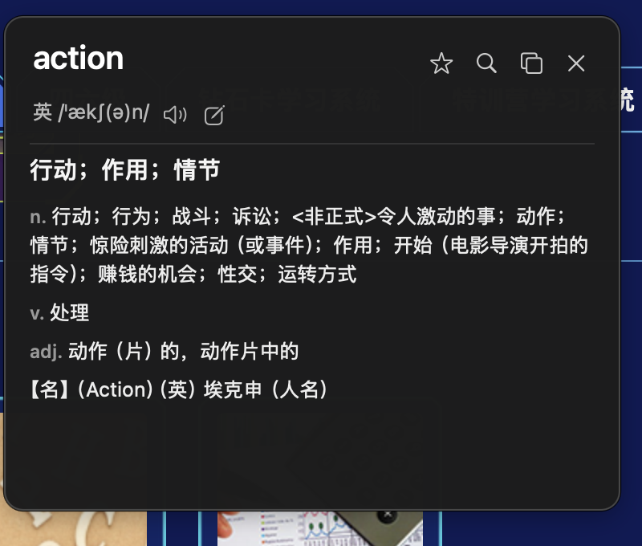
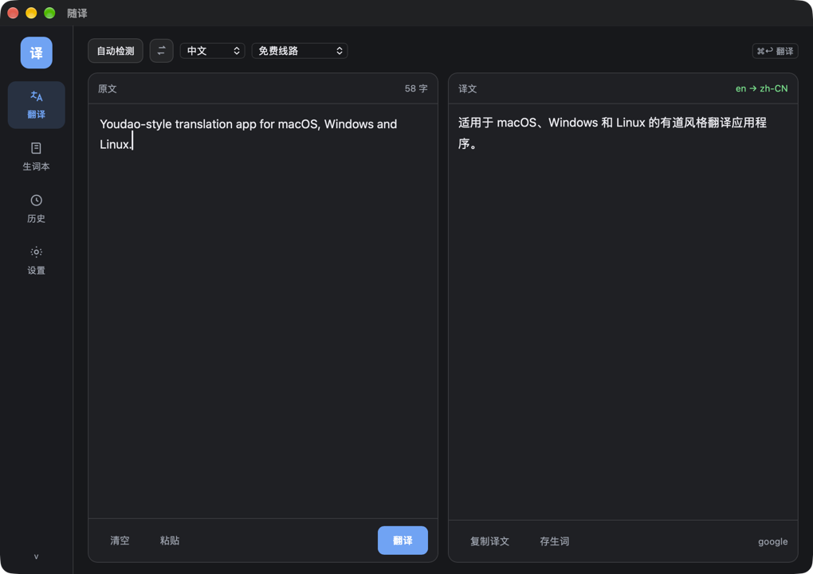

# 素笺 · Slip





选中任意应用里的文字，立刻在鼠标旁弹出译文。Windows / macOS 双端。

## 现在能做什么

- 全局监听鼠标：拖选文字后松开，自动抓取选区
- 两条线路：**免费线路**（Google，免 key，双入口轮换重试）／**DeepSeek 精翻**（需 key，自动注入术语表）
- **主界面**（`翻译 / 生词本 / 历史 / 设置` 四个页签）：左边输入原文、右边看译文，`⌘↩` 直接翻译，`Esc` 收起窗口
- **查词**：输入单个英文单词时，除了译文还会给出音标、词性、英文释义与例句（免 key 的 dictionaryapi.dev）
- 设置页：目标语言（10 种）、线路切换、DeepSeek key 与模型、术语表（一行一条 `原文 = 译文`）、开机自启、权限状态
- 鼠标旁弹出结果气泡：复制译文 / 存生词 / 朗读 / 查词 / ✨精解 / 改原文重译 / 关闭；点别处或 25 秒不悬停自动收起
- **全屏应用里也能划词**：气泡由独立的 macOS 助手进程（`slip-helper`）用 `NSPanel` 画出来，
  Safari、预览等进入全屏空间时照样浮在最上面（普通窗口做不到这件事）；Windows 侧用无边框置顶窗口实现
- **先出小图标再展开**：划词后选区旁先出现一个小图标，点它或悬停才展开译文；面板里的原文可以直接改，
  改完回车（macOS `⌘↩`）重译
- **单词即词典**：单个英文词显示音标、词性、多条释义；翻译页里输入单词或短语，也会在译文下方
  给出词典/逐词速览
- 历史记录窗口：搜索、复制译文、清空（本地 JSONL，最多留 2000 条）
- **生词本**：气泡上「存生词」一键收进自己的词库，历史窗口第二个页签里搜索、复制、删除、导出 Markdown
- **开机自启**：设置里勾一下，登录后自动常驻菜单栏 / 系统托盘（LaunchAgent / 注册表 / autostart）
- 托盘图标：左键打开主窗口（Windows），右键出菜单；菜单里有暂停划词、翻译剪贴板、设置…、历史记录…、退出（macOS 是点图标出菜单，另有「辅助功能权限…」）
- 配置文件：macOS `~/Library/Application Support/slip/config.json`、Windows `%APPDATA%\slip\config.json`（改完保存即生效，不用重启）

## 无界面自检

```bash
SLIP_PROBE=1 ./src-tauri/target/debug/slip   # 翻译链路
SLIP_PROBE=history ./src-tauri/target/debug/slip  # 历史读写
SLIP_PROBE=vocab ./src-tauri/target/debug/slip    # 生词本增删查 + Markdown 导出
SLIP_PROBE=autostart ./src-tauri/target/debug/slip # 开机自启开关（会先开后关，不留痕）
SLIP_PROBE=fallback ./src-tauri/target/debug/slip  # 备用线路 MyMemory
SLIP_PROBE=pipeline ./src-tauri/target/debug/slip  # 端到端（抓选区→翻译→写历史），不含鼠标钩子
SLIP_PROBE=clip ./src-tauri/target/debug/slip      # 翻译剪贴板
cargo test                                  # 解析与坐标换算的单元测试
# OK google → 你好，世界…
```

## 打包

```bash
npx tauri icon src-tauri/icons/source.png   # 生成 icns/ico/各尺寸 png
npx tauri build                             # 产物在 src-tauri/target/release/bundle/
```

`npx tauri build` 会先跑 `beforeBuildCommand`（`node scripts/make-helper.mjs`）：
macOS 上它会编出气泡助手 `slip-helper` 并打进 `Contents/Resources/helper/bin/`，
Windows / Linux 上直接跳过（助手是 macOS 独有的 NSPanel 进程）。
所以**不用手动执行任何脚本**，`npm ci && npx tauri build` 就够了。

Windows 上构建的额外前提：Rust 1.77+ 与 VS 生成工具（MSVC），
以及给 cargo 设 `CARGO_PROFILE_DEV_DEBUG=0`（否则 `ring` 的 cc-rs 会传 `/Z7`，撞上 `cl.exe D8050`）。

## 运行

```bash
npm install                 # 只装 tauri CLI
npm run dev                 # 开发模式（会编译 Rust，首次较慢）
npm run build               # 打 .app / .dmg（macOS 专用脚本；Windows 用 npx tauri build）
```

Windows 上不要用 `npm run build`（它调的是 macOS 的 `scripts/build.sh`，里面是 `codesign`），直接：

```powershell
npx tauri build             # 产物：src-tauri/target/release/bundle/nsis/素笺_x.y.z_x64-setup.exe
                            # 发到 GitHub Release 时 workflow 会重命名成 Slip_x.y.z_x64-setup.exe（纯 ASCII）
```

Windows 首次编译需要 Rust（rustup）+ Visual Studio 生成工具（MSVC + Windows SDK），
装好后 `cargo check` 若在 `ring` 的 `c1.dll` 上报 `D8050`，是 dev profile 的 `/Z7` 调试信息引起的，
用 `CARGO_PROFILE_DEV_DEBUG=0` 再编译即可（release 构建不受影响）。

首次运行 macOS 版需要给 **辅助功能（Accessibility）** 权限：
系统设置 → 隐私与安全性 → 辅助功能 → 勾选「素笺」。
没有这个权限，读不到选区、也发不出 ⌘C。Windows 不需要任何授权。

## 目录

```
src/bubble.html            气泡窗口（结果卡片）
src-tauri/src/main.rs      托盘、气泡定位、鼠标监听编排
src-tauri/src/capture.rs   模拟 ⌘C 抓选区 + 剪贴板还原
src-tauri/src/translate.rs 翻译线路（Google 免费接口）
```

## 已知限制（待办）

- 只有中文界面
- 气泡的 macOS 部分拆成了两个进程（主程序 + `slip-helper`），排查问题时要看两边的日志：
  主程序 `slip.log`，助手在同目录（`bubble-helper.pid` 里是它的 pid）。Windows 只有主程序一个进程。
- macOS 分发需要签名与公证，否则别人首次打开会被 Gatekeeper 拦
- Windows 版的两个平台限制（系统没有公开 API，做不到）：  - 气泡浮在**独占全屏**（DirectX exclusive，部分游戏/播放器）之上做不到；无边框全屏（浏览器 F11）没问题
  - 气泡只在**创建它的虚拟桌面**上可见，不会像 macOS 的 `canJoinAllSpaces` 那样跟随所有桌面
  - 以管理员权限运行的窗口（任务管理器、UAC 提权程序）里划词收不到：Windows 的 UIPI 不允许低权限程序读到高权限窗口的输入与选区
- Windows 的气泡按住卡片空白处可拖动，弹出来不会抢焦点（和 macOS 的 NSPanel 一样）；点原文进编辑态时会临时接过焦点，重译完再还给你原来的窗口
- 拔显示器 / 改缩放之后，已经显示的气泡会在两秒内自动挪回屏幕内，不会「消失在外接屏」
- 本机开发用自签证书固定签名（否则每次重编译「辅助功能 / 输入监控」授权都会失效）：
  ```bash
  security create-keychain -p slip-build ~/Library/Keychains/slip-signing.keychain-db
  security set-keychain-settings -lut 86400 ~/Library/Keychains/slip-signing.keychain-db
  security import cert.p12 -k ~/Library/Keychains/slip-signing.keychain-db -P slip \
    -T /usr/bin/codesign -T /usr/bin/security -A
  security set-key-partition-list -S apple-tool:,apple:,codesign: -s -k slip-build \
    ~/Library/Keychains/slip-signing.keychain-db
  security list-keychains -d user -s ~/Library/Keychains/login.keychain-db \
    ~/Library/Keychains/slip-signing.keychain-db
  ```
  之后用 `npm run build`（会先解锁钥匙串再打包，避免 codesign 卡在系统密码弹窗）。

## 双端支持

| 平台 | 抓选区方式 | 状态 |
| --- | --- | --- |
| macOS 12+ | 模拟 ⌘C（兜底系统辅助功能接口 AX） | 已跑通，需在「辅助功能」里授权 |
| Windows 10/11 | 优先 UI Automation 的 TextPattern，取不到再用模拟 Ctrl+C（先写哨兵再判定，结果必还原剪贴板） | 已跑通，无需授权 |

两端功能对齐：划词先冒小图标、悬停/点击展开、单词卡片（音标/词性/多义/例句/更多释义）、
✨AI 精解、朗读、查词、改原文重译、存生词、复制、25 秒不悬停自动收起、托盘菜单、开机自启。

实现差异（平台能力不同，效果一致）：
`NSPanel` 换成一个 36×36 的置顶 webview 窗口；`AVSpeechSynthesizer` 换成 WebView2 的 `speechSynthesis`；
`AXSelectedText` 换成 UI Automation 的 `TextPattern`；气泡高度由前端量内容后回传，不再写死。

Windows 上怎么判断「这次拖拽到底选中了没有」：拖拽落点如果是桌面/任务栏这类 shell 表面，或者
松手时窗口不是前台窗口（Ctrl+C 会打到别的程序上、复制走它的旧选区），直接跳过；拿到选区后还会
把文本的包围盒和这次拖拽的矩形求交，对不上就判定为「选区别处」放弃。这样按住左键在空白处划一下
不会再把上一次的残留选区翻出来。

排障开关（可以单独设，也可以组合）：

- `SLIP_NO_COPY=1`：跳过模拟 Ctrl+C，只用 UI Automation 读选区（慢一点，但对 Chromium/Office/WPF/UWP/记事本都有效）。
- `SLIP_NO_AX=1`：反过来，只用模拟 Ctrl+C（某些自绘控件、远程桌面里 UIA 会一直报「没有选区」时用这个）。
- `SLIP_DEBUG_COPY=1`：把复制这条路每一步写进日志（`copy: fg class=…`、`copy: attempt N seq=…`、
  `copy: poll len=… wrote=… captured=…`），划词抓不到时先开这个看看到底卡在哪一步。

`.github/workflows/release.yml` 里已经把双端的依赖和构建矩阵写好了（打 tag 触发，并自动把安装包挂到 Release）。

## 权限要求

- **macOS**：系统设置 → 隐私与安全性 → 「辅助功能」+「输入监控」都要给「素笺」打开。
  没授权时菜单栏图标仍在，但划词不会触发；授权后新版会自动挂上钩子，不用重启。
- 重新编译覆盖 `/Applications/素笺.app` 之后，macOS 可能把它当成新程序：如果授权过却仍无反应，
  去列表里把「素笺」删掉（− 号）再重新勾一次。
- **Windows**：无需额外授权。只有以管理员权限运行的窗口（任务管理器等）要同权限运行本程序才能划词。

## 常见问题

- **选中没反应**：先看日志 —— macOS `~/Library/Application Support/slip/slip.log`，
  Windows `%APPDATA%\slip\slip.log`（设置 `SLIP_TRACE=1` 启动会打印每个鼠标事件）。
- **译不出来**：设置里换线路试试；Google/Bing 免密钥但有频率限制，长文本建议用 DeepSeek 精翻。
- **气泡位置怪**：多屏 / 缩放比例不同时会在屏幕边界内夹取；Windows 上高 DPI 已按显示器 scale 折算。
- **Windows 安装时被 SmartScreen 拦**：安装包没有代码签名，点「更多信息 → 仍要运行」。
  首次启动会自动用 WebView2 的引导程序装运行时（Win11 自带，Win10 可能需要联网装一次）。


## 下载

见 https://github.com/Souffle-78/slip/releases

- Windows：`Slip_x.y.z_x64-setup.exe`，双击安装，托盘出现图标即可使用
- macOS：`Slip_x.y.z_aarch64.dmg`（Apple 芯片）/ `Slip_x.y.z_x64.dmg`（Intel）
